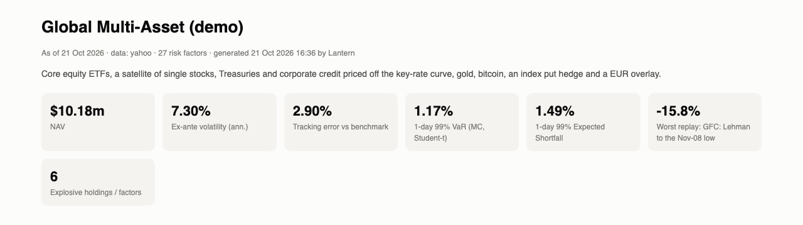
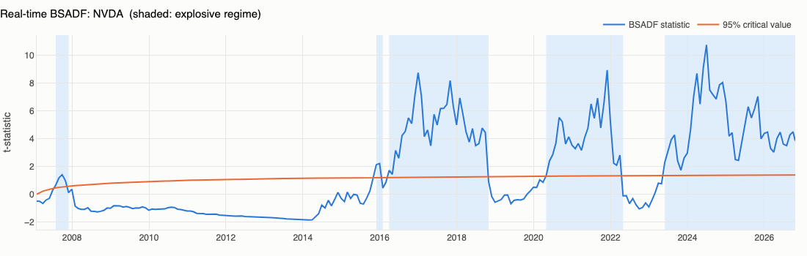
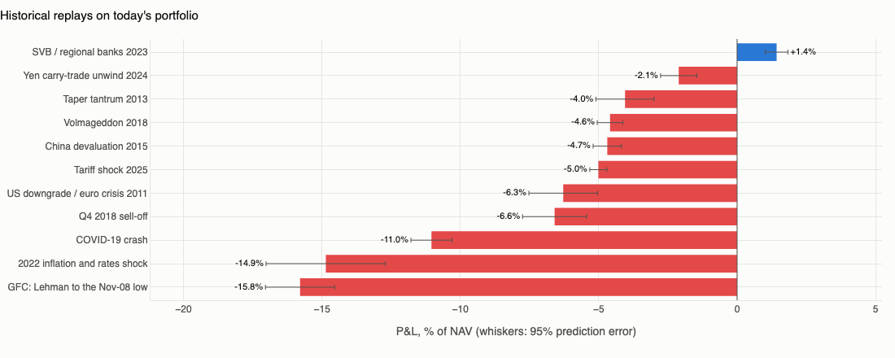
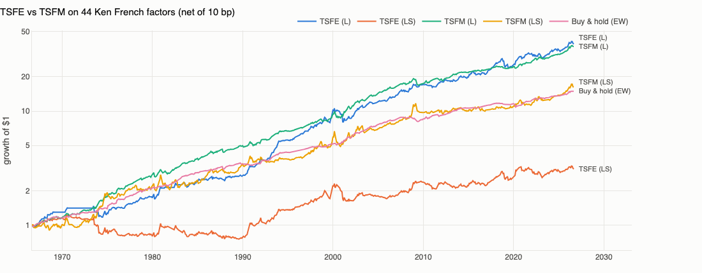
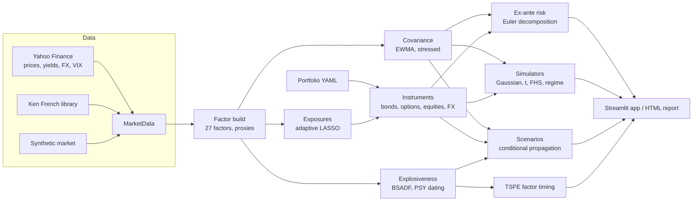

# 🏮 Lantern

**An open-source, Aladdin-style platform for cross-asset factor risk, scenario simulation and systematic factor investing.**

Lantern rebuilds, in under 4,000 lines of Python, the analytical core that institutional
platforms such as BlackRock's Aladdin describe publicly:

- one cross-asset **factor risk model**
- **full-revaluation pricing** of every holding
- **Monte Carlo and historical VaR/ES**
- **market-driven scenarios** with conditional shock propagation
- a **factor workbench** for portfolio construction

It adds one capability that comes from my PhD research: a **real-time explosiveness
(bubble) monitor**. The monitor generates statistically grounded *bubble-burst*
scenarios and drives a factor-timing strategy (TSFE).

> Independent project built only from public information and public data. It is not
> affiliated with, endorsed by or derived from BlackRock's software. Not investment advice.



The full sample report is in [`docs/demo/lantern_report.html`](docs/demo/lantern_report.html).
Run `lantern report` to regenerate it with today's data.

---

## What it does

| Aladdin capability (public description) | Lantern module | How |
|---|---|---|
| A risk model with thousands of factors across rates, credit, FX, equity and commodities | `factors/` | 27 factors built from public prices: Treasury key rates, IG/HY spreads, breakevens, regional equity, iShares style factors (size, value, momentum, quality, min-vol), sectors, FX, commodities, Bitcoin, VIX. Short histories are back-filled from proxies such as Fama-French factors. |
| Holdings-based, forward-looking (ex-ante) risk | `risk/parametric.py` | EWMA covariance with a 63-day half-life for volatility and 252 days for correlation, plus PSD repair. Euler decomposition of volatility and tracking error by factor, factor group and position. |
| "Return-regression" mapping of funds and securities | `factors/exposures.py` | Exponentially weighted **adaptive LASSO** (Zou 2006). It selects a sparse set of factors among correlated ones, refits them by WLS, and treats the residual as specific risk. |
| Pricing and analytics across asset classes ("180 million option-adjusted calculations a week") | `instruments/` | Fixed-coupon bonds on a key-rate curve with an analytic KRD, spread duration and convexity. Black-Scholes options whose implied vol moves with VIX. Equities and ETFs, FX forwards, cash, and generic "building-block" proxies. |
| Monte Carlo VaR and stress testing | `simulation/`, `risk/var.py` | Gaussian, multivariate Student-t, **filtered historical simulation** and a **calm/stress regime mixture**, all with full revaluation. Also historical simulation, stressed VaR, Euler ES contributions, Kupiec/Christoffersen backtests and Basel traffic lights. |
| Market-Driven Scenarios: shock a few variables and imply the rest from modeled relationships, with a prediction error | `scenarios/propagation.py` | Conditional Gaussian propagation `E[x_u | x_k = s] = S_uk S_kk⁻¹ s`, with conditional covariance giving the 95% prediction error. Security-level shocks ("NVDA −30%") are supported. Plausibility is reported as a Mahalanobis distance and a return period. |
| Historical scenario library | `scenarios/library.py` | Eleven episodes, from Lehman to the 2025 tariff shock. Factors that did not exist yet (Bitcoin in 2008) are filled by conditional expectation. Thirteen hypothetical scenarios with a severity dial. |
| Factor Workbench: express allocations as factor exposures and target them | `systematic/optimizer.py` | Hits target factor exposures with the least tracking error on the structured covariance `B S B' + D`. Also risk parity, minimum variance and maximum diversification. |
| Systematic investing | `systematic/` | Real-time BSADF explosiveness tests (Phillips-Shi-Yu) with Monte Carlo critical values, the **TSFE** factor-timing strategy, the TSFM benchmark, and a common-factor (systemic) bubble monitor based on incremental PCA. |
| Dashboards and reporting | `app/`, `reporting/` | Streamlit dashboard with eight tabs, plus a self-contained HTML risk report. |

### Research contribution: explosiveness-triggered scenarios

Narrative stress tests depend on judgment for two choices: *which* shock to run and
*how large* to make it. Lantern's bubble overlay makes both choices from the data:

1. Every factor and holding is tested each month with the real-time BSADF statistic.
2. When a series is explosive, the PSY origination date of the live episode is located.
3. The scenario reverses 25%, 50% or 100% of the log run-up since origination.
4. The shock is propagated to all other factors under the **stressed** covariance.

The result is a data-driven version of the market-driven scenario workflow. Its trigger
and its size both come from a test with known size and power.




### Factor timing: explosiveness vs momentum

`lantern zoo` runs the TSFE strategy of *Li & Urga, "Timing the Factor Zoo: Explosiveness
Beyond Momentum"* on 44 long-short factors from the Kenneth French library (US plus six
international regions, 1966 to 2026). The paper itself uses the 153 JKP factors; to
replicate it, pass `--jkp <file>` with a file from [jkpfactors.com](https://jkpfactors.com).



On the 44 French factors, net of 10 bp round-trip costs:

| Strategy | Sharpe | FF3 alpha (%/mo) |
|---|---|---|
| TSFE (L) | 0.86 (0.92 gross) | 0.54 (t = 6.0) |
| TSFM (L) | 1.23 | 0.46 (t = 9.0) |

On this smaller and less diverse set, momentum timing has the higher Sharpe ratio, while
explosiveness timing earns the larger alpha. The paper's comparison uses the full 153-factor
zoo.

---

## Quick start

```bash
git clone https://github.com/Raymondli073/lantern-risk.git && cd lantern-risk
python -m venv .venv && source .venv/bin/activate
pip install -e ".[all]"           # numba (fast BSADF), streamlit, pytest

lantern report                    # live data -> reports/lantern_report.html
lantern report --synthetic        # fully offline: built-in synthetic market
lantern risk                      # risk, VaR, scenarios and bubble flags in the terminal
lantern zoo                       # TSFE vs TSFM on the French factor zoo
lantern app                       # Streamlit dashboard (or: streamlit run app/streamlit_app.py)
pytest                            # 28 tests, offline
```

From Python:

```python
from lantern import Lantern, Portfolio
from lantern.scenarios.library import pct, bp

lt = Lantern(Portfolio.from_yaml("examples/multi_asset.yaml"))   # synthetic=True for offline

lt.risk().by_group                       # Euler risk contributions by factor group
lt.active_risk().summary()               # ex-ante tracking error vs the YAML benchmark
lt.var("fhs", alpha=0.99, horizon=10)    # filtered historical simulation, full revaluation
lt.var_comparison()                      # parametric / Gaussian / t / FHS / historical / regime / stressed

r = lt.scenario({"EQ.US": pct(-0.15), "UST.10Y": bp(-40)}, horizon_days=21)
r.pnl, r.pred_error_95, r.mahalanobis    # P&L, 95% prediction error, shock size in sigmas
lt.scenario({}, security_shocks={"NVDA": pct(-0.30)})   # security-level shock

flags = lt.bubble_scan()                 # BSADF state of every factor and holding
lt.bubble_scenarios(flags)               # burst scenarios under the stressed covariance
```

Portfolios are YAML lists of positions (`etf`, `equity`, `crypto`, `bond`, `option`,
`fx_forward`, `cash`, `proxy`) plus an optional benchmark. See
[`examples/multi_asset.yaml`](examples/multi_asset.yaml).

## Architecture



The methodology for every model is in [`docs/methodology.md`](docs/methodology.md). The research
on Aladdin that shaped the design, with sources, is in
[`docs/aladdin_research.md`](docs/aladdin_research.md).

## Data and limits

- Prices come from Yahoo Finance's public chart endpoint and are cached under
  `~/.cache/lantern` (override with `LANTERN_CACHE`). Factor returns come from the Kenneth
  French Data Library. No data is redistributed in this repository.
- Credit spreads are *implied* from duration-hedged ETF returns (LQD/IEF, HYG/IEI), not
  observed OAS. Treasury yields are treated as zero rates. Both are second-order
  approximations for risk work.
- The 27-factor model is deliberately compact. Production models carry thousands of
  factors, a fundamental equity model and issuer-level credit curves.
- The demo portfolio is illustrative. The single stocks were chosen with hindsight.

## Author

Zhuangyan (Raymond) Li, PhD candidate in Financial Econometrics at Bayes Business School (formerly Cass), London.
The research covers explosive time series, real-time
bubble detection and factor timing. The explosiveness code follows the thesis' validated
implementation: the numba and numpy paths agree to machine precision, and the critical
values match the original Monte Carlo design.

## License

MIT
